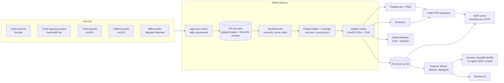

# Travis County Oracle: property intelligence pipeline

A continuous, incremental pipeline that loads Travis County, TX property and ownership data (TCAD), City of Austin permits, contractors, archived BBB grades and coordinates into DuckDB-queryable Parquet tables. It publishes every snapshot to public IPFS as content-addressed artifacts and serves it to a browser UI, an agent and MCP clients. Oracle carries no infrastructure cost: everything runs on free plans.

The original brief is in [docs/ASSIGNMENT.md](docs/ASSIGNMENT.md).

## Try it

| What | Where |
|---|---|
| Explorer: run history, IPFS manifest with live gateway checks, leads map, SQL, agent, MCP console | https://travis-oracle-explorer.curiousily.workers.dev |
| Latest dataset root (directory CID) | `bafybeicoluracttpsh4wv23hwamtxrnse2ttwute2fmw45j7xffp47nwgi` |
| Latest artifact manifest (file CID) | `bafkreifvwkazir7b4qmewtv5q6nsxkoxbq23f6usshshkbbmgfju3kdypm` |
| IPNS name (pointer to the latest manifest) | `k51qzi5uqu5dkkce5c4ypc8o1xsrybtdhfae3ec2f3nbhz5ht1c4msv89ftm5c` |
| CARs and manifests of every publication | [GitHub Releases](https://github.com/curiousily/oracle-property-intelligence-platform-pipeline-travis-tx/releases) |
| MCP server | `npm ci && npm run --silent mcp` (see [MCP](#mcp)) |
| Roofing CRM built on this dataset | https://roofing-crm.curiousily.workers.dev ([repository](https://github.com/curiousily/roofing-crm/tree/travis-crm)) |

Open any CID on a public gateway this project does not operate. ipfs.orbitor.dev and gw.ipfs-lens.dev are run by neither this project nor its pinning vendors. The brief's examples, ipfs.io and dweb.link, no longer serve arbitrary content (they return 429 or were retired in 2026):

```bash
curl -s https://ipfs.orbitor.dev/ipfs/bafkreifvwkazir7b4qmewtv5q6nsxkoxbq23f6usshshkbbmgfju3kdypm | jq '.objects[] | {name, cid, size, sha256}'
curl -s https://gw.ipfs-lens.dev/ipfs/bafybeicoluracttpsh4wv23hwamtxrnse2ttwute2fmw45j7xffp47nwgi/coverage.json | sha256sum
curl -sI https://ipfs.orbitor.dev/ipns/k51qzi5uqu5dkkce5c4ypc8o1xsrybtdhfae3ec2f3nbhz5ht1c4msv89ftm5c | grep -i x-ipfs-roots
```

## What the dataset holds

Publication `20261027T100024Z`:

| Table | Rows | What a row is |
|---|---:|---|
| `properties` | 453,713 | One TCAD property: situs address, owners and mailing address, owner locality, deed date and ownership years, values, year built, roof covering, estimated roof age with its basis and confidence, roofing-permit counts, coordinates with their source |
| `roofing_permits` | 37,613 | One roofing permit: kind of roof work, status, permit state, open-since date, years open, expiry, contractor, BBB grade as of its snapshot date, linked TCAD property, coordinates, link to the city record |
| `contractors` | 6,062 | One reconciled roofing contractor: every name and phone used on permits, permit counts, BBB grade, accreditation, how and how confidently the BBB profile was matched |
| `permits` | 2,381,903 | Every City of Austin permit, all types, with dates, contractor fields and the linked TCAD property |

Coverage highlights, from the published `coverage.json`:
- 445,201 properties located (98.1%).
- 279,287 roofs older than 15 years.
- 5,016 roofing permits never finished. 3,708 of them have been unfinished for 5+ years: 21 are still open, and the rest expired without a final inspection. Searches return still-open permits by default; expired ones are opt-in.
- 155,897 properties held more than 10 years.
- 48,530 owners outside the Austin area.
- 206 contractors with a BBB grade, matched against 1,589 archived BBB profiles. The profiles are used for grading only and are not published as a table of their own.

Every published snapshot also contains:
- `build.json`: inputs, source row counts, per-table deltas.
- `runs.json`: every ingest run and earlier build.
- `sources.json`: publisher, refresh strategy and limitations of each source.
- `samples/*.csv`: aged roofs and long-open roofing permits.

## How it works



### Continuous and incremental

| Source | Change detection | Typical incremental run | First full load |
|---|---|---:|---:|
| Austin permits (Socrata `3syk-w9eu`) | Business-date window: status, issue or applied date on or after the watermark minus a 7-day lookback; keyset paging by permit number, 50,000 rows a page | 14–43 s | 13 min, 2.38 M rows in 48 pages |
| TCAD appraisal export | Export catalog page; downloads only a new year or supplement | 14–26 s (unchanged) | 73 s for 511 MB |
| TCAD parcels (ArcGIS) | Layer edit date | 14–21 s (unchanged) | 60 s, 386 k features |
| Address points (ArcGIS) | Layer edit date | 18–22 s (unchanged) | 77 s, 466 k features |
| BBB archive (Wayback) | CDX capture index; fetches only captures not archived yet, known contractors first | 20 min time box, about 770 profiles | grows each day until the index is exhausted |

- **Schedule.** Ingest and build run daily at 16:30 UTC, after the city republishes its permits. Publication runs weekly, Mondays at 17:45 UTC, and either can be dispatched by hand ([ingest.yml](.github/workflows/ingest.yml)).
- **Idempotent and recorded.** Every source writes a watermark only after its raw pages and run record are stored. Every run writes a JSON record (timestamps, window, pages, records, watermark, receipts).
- **Builds.** Each build reports per-table deltas (`added`, `changed`, `removed`), keyed by stable ids and compared on content without provenance columns. A row whose content did not change keeps the previous build's `source_run_id`, even when a newer run re-read it. Unchanged tables therefore come out byte-identical and keep their CIDs; consecutive builds on the full data hash identically.
- **Publications.** A publication never mutates an earlier CID. Its manifest links the previous manifest and root (`previous`), IPNS moves to the new manifest, and all publications stay listed in the explorer and in Releases.
- **Pin retention.** Filebase keeps the last 30 publications pinned and Pinata the last 3. Every publication's CAR stays on GitHub Releases, so anyone can import and re-pin an older snapshot by CID.

### Reconciliation and derived signals

- **Properties.** TCAD rows are reconciled to one row per property id; multiple owners keep the primary owner plus every name.
- **Permit links.** Permits link to properties by TCAD parcel id. Each permit carries a link status: linked, ambiguous parcel, missing parcel id, or parcel not in the roll.
- **Contractors.** Free-text company names and phones are normalized into contractor keys, and placeholder phones are ignored.
- **Coordinates.** Each property takes the first available of: its own parcel centroid, then a shared parcel (condos and mobile homes), then a county address point (unique within about 400 m), then permit coordinates. The source used is recorded per row.
- **Roof age.** The most recent completed reroof permit gives high confidence, a completed new-construction permit medium, and the improvement's year built low. Basis, date, permit and confidence are kept on every row.
- **Permit lifecycle.**
  - State: open, expired, abandoned, completed or unknown.
  - Never finished: open, or expired without a final inspection.
  - Open since: the issue date (or the applied date).
  - Years open, and whether the permit is past its expiry.
- **Owner locality.** From the mailing address: local (Austin-metro ZIP 786/787), regional (elsewhere in Texas), out of state, or foreign. Ownership years come from the deed date.
- **BBB matching.** Matched by name and phone (high confidence), unique phone (medium), unique name (medium), or a single Austin-metro business among same-named ones (low). Each grade is shown as of its archived snapshot date, with the archive URL.
- **Provenance.** Every row carries `source` and `source_run_id`; permits carry the city's record URL.

## Query layer, agent and MCP

`packages/query-core` defines the validated query tools, so the explorer, the agent, the MCP server and the CRM all share one data model:

| Tool | Answers |
|---|---|
| `find_aged_roofs` | Properties with roofs older than N years (default 15) within a radius of a place or point. Best-evidenced first. |
| `find_open_roofing_permits` | Roofing permits still open N+ years (default 5), longest open first, with contractor and BBB grade. Expired-without-final, accessory work and contractor-only are options. |
| `find_long_held_properties` | Properties whose owner has held them more than N years (default 10). |
| `find_out_of_area_owners` | Properties whose owner mails from outside the Austin area. |
| `property_details`, `contractor_details` | One property with its roofing permits; one contractor with its BBB grade and permits. |
| `locate_place`, `dataset_summary` | Census place coordinates; build id, CIDs and coverage of the dataset being queried. |

Inputs are zod schemas exported as JSON Schema. Every result carries the SQL that produced it, the dataset CIDs and, for radius searches, `summary` counts over all matches (for example how many list a contractor or a BBB grade).

### Agent

The explorer's **Agent** tab answers questions like "Which properties within five miles of Pflugerville have roofs older than 15 years?":
- A Workers AI model (`@cf/qwen/qwen3-30b-a3b-fp8`) chooses the tools.
- The tools run in the browser with DuckDB-WASM over the published Parquet.
- Each answer lists the evidence rows, the SQL, the roof-age basis and the gaps.

The Worker adds the system prompt and tools itself and validates the conversation. It caches identical conversations in KV and caps the app at 4,500 neurons a day (the account's free allocation is 10,000 a day).

### MCP

```bash
npm ci
claude mcp add travis-oracle -- npm run --silent mcp --prefix "$PWD"   # or any MCP client: npm run --silent mcp
```

- **Tools.** The stdio server exposes every query tool, `get_schema` (columns and types of every table) and a read-only `run_sql`. DuckDB parses each statement and only a single SELECT is allowed.
- **Data.** It reads the latest publication's Parquet over HTTP. DuckDB external access is locked to that dataset's URL prefix.
- **`TRAVIS_ORACLE_GATEWAY`.** Set it to `https://ipfs.orbitor.dev` to query straight from public IPFS with no project infrastructure.
- **`TRAVIS_ORACLE_ROOT_CID`.** Set it to pin any published snapshot.

## Source limitations and speed

These limitations are published with every snapshot (`sources.json`) and shown in the explorer.

- **Permits.** Covers the City of Austin only. Other cities in Travis County and unincorporated areas issue their own permits, so roof age outside Austin relies more on year built.
- **City republishing.** The city republishes the whole permits dataset daily (about 14:40–15:05 UTC). Changes are therefore found through business dates, with a 7-day lookback.
- **Large pages.** Some 50,000-row Socrata pages exceed 70 MB of JSON. DuckDB needs a 128 MiB JSON object buffer for them.
- **TCAD access.** TCAD web pages refuse some automated clients and regions; the bulk export downloads normally. Exports are periodic supplements, not daily.
- **BBB.** bbb.org refuses automated clients and has no public API. Grades come only from Internet Archive snapshots, never from bbb.org directly.
  - Only archived profiles exist, and grades can be stale; each is shown with its snapshot date.
  - The CDX index and snapshots are slow, so each run is time-boxed at one request a second and continues where the last run stopped.
- **Coordinates.** Parcel centroids mark parcels, not roofs. Condos and mobile homes share a parcel and fall back to address points.
- **Network.** data.texas.gov and gis.traviscountytx.gov time out from outside the US, which is why ingestion runs on GitHub-hosted US runners.

## Cost

| Role | Platform | Plan |
|---|---|---|
| Ingest, build, publish, deploy | GitHub Actions (public repository) | Free |
| Raw store, builds, CID mirror | Cloudflare R2 | Free tier (10 GB-month, no egress fees) |
| Explorer and agent proxy | Cloudflare Workers + static assets | Free plan (100,000 requests a day) |
| Agent model | Workers AI | Free 10,000 neurons a day |
| Answer cache, budget | Workers KV | Free tier |
| Query engine | DuckDB-WASM in the browser, DuckDB in the MCP server | No database server |
| Durable storage | IPFS via Filebase (CAR import, IPNS) and Pinata | Free plans |

## Run it yourself

```bash
nvm use && npm ci
npm test && npm run typecheck && npm run lint

# Ingest each source into ./packages/pipeline/data, then build the tables
npm run ingest -w @travis-oracle/pipeline -- austin-permits
npm run ingest -w @travis-oracle/pipeline -- tcad-appraisal-export
npm run ingest -w @travis-oracle/pipeline -- tcad-parcels
npm run ingest -w @travis-oracle/pipeline -- travis-address-points
npm run ingest -w @travis-oracle/pipeline -- bbb-archive --budget-minutes 5
npm run build-leads -w @travis-oracle/pipeline

# Encode the IPFS dataset without publishing, or publish with FILEBASE_* and PINATA_JWT set
npm run publish -w @travis-oracle/pipeline -- --dry-run
# Verify any published manifest on the public gateways
npm run verify -w @travis-oracle/pipeline -- --cid bafkreifvwkazir7b4qmewtv5q6nsxkoxbq23f6usshshkbbmgfju3kdypm

# Explorer
npm run dev -w @travis-oracle/explorer          # local Worker + UI (needs wrangler login)
npm run e2e -w @travis-oracle/explorer          # Playwright playthrough against the deployed explorer
```

The CI secrets are `CLOUDFLARE_API_TOKEN`, `CLOUDFLARE_ACCOUNT_ID`, `FILEBASE_ACCESS_KEY_ID`, `FILEBASE_SECRET_ACCESS_KEY`, `FILEBASE_BUCKET` and `PINATA_JWT`. R2 S3 credentials are derived from the Cloudflare token ([r2-credentials](.github/actions/r2-credentials/action.yml)).

## Repository layout

| Path | Contents |
|---|---|
| `packages/pipeline` | Domain rules (pure, unit-tested), application use cases, infrastructure adapters (Socrata, ArcGIS, TCAD export, Wayback, DuckDB warehouse, UnixFS/CAR encoder, Filebase, Pinata, gateway verifier), CLI commands |
| `packages/query-core` | Validated query tools and their SQL, shared by every client |
| `packages/explorer` | Cloudflare Worker (IPFS mirror route, Workers AI proxy) and React UI (DuckDB-WASM, MapLibre) |
| `packages/mcp` | Stdio MCP server |
| `.github/workflows` | `ingest` (ingest, build, publish), `explorer` (test, deploy, end-to-end playthrough), `ci`, `source-access` |

## Kit conformance and deviations

The soofi-xyz team kit is enabled in this repository (`.claude/settings.json`), and its Elephant oracle skills are pinned (`skills-lock.json`).

**Followed**, from the kit's county query-table pattern (`county-query-table-publish`, `deploy-open-data-mcp`):
- one row per property in a Parquet query table on public IPFS via Filebase, behind an IPNS name
- DuckDB range-reading that table straight from a gateway
- an MCP server with a schema tool (`get_schema`) and read-only SQL next to the task tools

**Not followed:**
- **Hosting.** The kit's golden path is AWS (Amplify, CDK and tRPC for full-stack work; Bedrock and OpenSearch for agents). This project runs on Cloudflare's free plan instead, because the brief requires that Oracle carry no ongoing infrastructure cost.
- **Publication path.** The kit's `oracle` agent publishes Lexicon data groups through elephant-cli and an Atlas county page. Those groups are not produced here. Publication is a self-describing UnixFS snapshot with its own manifest, CAR and IPNS pointer.
- **Contractor identity.** The kit resolves contractors against an official corporate registry and licensing authority. Here they are reconciled from permit names and phones, plus archived BBB profiles.

## Known gaps

- **Permits outside the City of Austin.** They are not in the dataset (see [Source limitations](#source-limitations-and-speed)).
- **BBB coverage.** It grows about 770 archived profiles a day until the archive index is exhausted. Matching stays heuristic and carries a confidence.
- **No hosted MCP endpoint.** The MCP server is stdio, run from a clone. A Worker on the free plan cannot run DuckDB, so the hosted surfaces are the explorer and its in-browser tool console.
- **R2 retention.** Builds and raw pages are kept indefinitely; expiring old builds is the next step to stay inside the 10 GB free tier.
